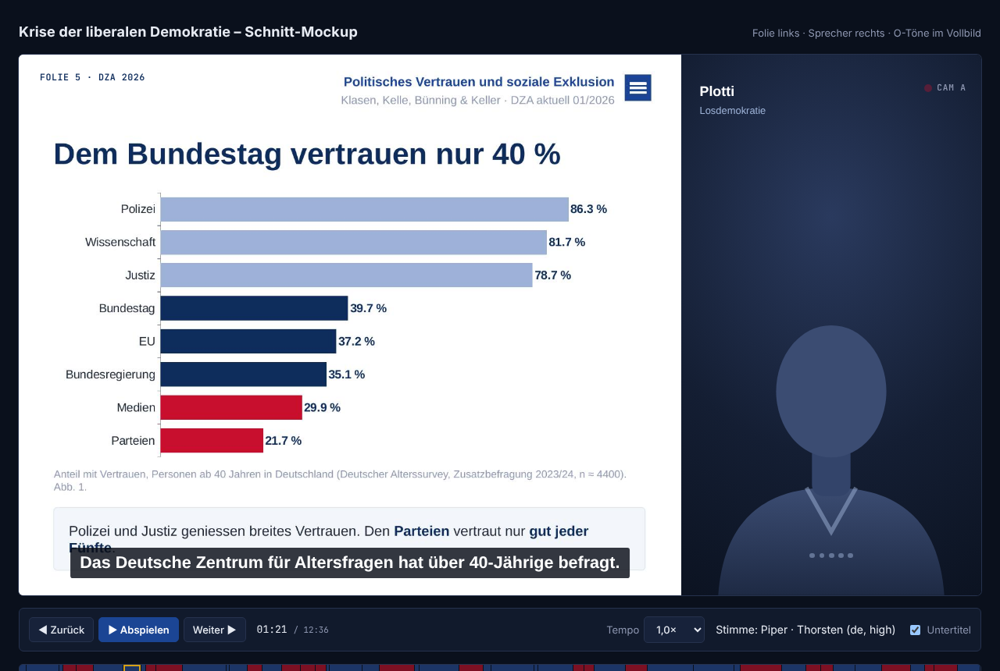
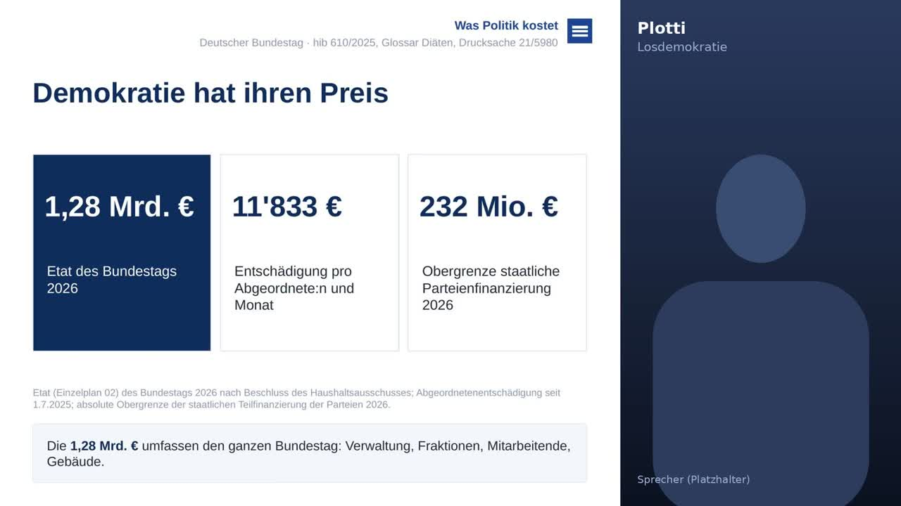

# AI Video Toolkit

Turn a written script into a **reviewable rough cut** of an evidence-based explainer video, before you record a single take.

You write the script (with cues for slides and video quotes). The toolkit then:

1. reads the script aloud with a free text-to-speech voice,
2. builds a clickable **cut mockup** in the browser: slide on the left, speaker on the right, video quotes full screen,
3. renders the whole thing as a **preview MP4**,
4. exports every video quote as a separate **1080p clip with 5 s handles** for your editing software,
5. lists every quote with a **rights traffic light** (can I use this?).



*The cut mockup: slide left, speaker placeholder right, timeline and script below. Video quotes play full screen with their original sound.*



*A frame from the rendered preview MP4.*

It was built for a German YouTube channel, so the script format and a few labels are in German (*Drehfassung* = shooting script, *O-Ton* = video quote, *Folie* = slide). Everything works for any language.

---

## Contents

- [What you need](#what-you-need)
- [Try it in 5 minutes (demo)](#try-it-in-5-minutes)
- [Make your own video, step by step](#make-your-own-video-step-by-step)
- [The script format](#the-script-format)
- [The clip list (`clips.json`)](#the-clip-list-clipsjson)
- [Rights traffic light](#rights-traffic-light)
- [Troubleshooting](#troubleshooting)

---

## What you need

| Tool | What for | Install (macOS with Homebrew) |
|---|---|---|
| Python 3.10+ | runs the scripts | `brew install python` |
| ffmpeg | audio/video processing | `brew install ffmpeg` |
| poppler | turns your slide PDF into images | `brew install poppler` |
| yt-dlp | downloads video quotes (only if you use YouTube/online clips) | `brew install yt-dlp` |
| Pillow, Piper | images, text-to-speech | `pip3 install pillow piper-tts` |

On Linux use your package manager (`apt install ffmpeg poppler-utils`) and `pip install yt-dlp pillow piper-tts`.

Get the code:

```bash
git clone https://github.com/plotti/ai-video-toolkit
cd ai-video-toolkit
```

---

## Try it in 5 minutes

The `demo/` folder is a tiny project with two slides and four sentences of script. No video quotes, no downloads except the voice.

**1. Download a voice** (about 60 MB, once per voice):

```bash
cd demo/tts
curl -LO https://huggingface.co/rhasspy/piper-voices/resolve/main/en/en_US/lessac/medium/en_US-lessac-medium.onnx
curl -LO https://huggingface.co/rhasspy/piper-voices/resolve/main/en/en_US/lessac/medium/en_US-lessac-medium.onnx.json
cd ../..
```

**2. Read the script aloud:**

```bash
python3 tts.py demo
# -> 4 Sätze, 11.0 s Sprechzeit
```

**3. Build the mockup and open it:**

```bash
python3 build_mockup.py demo
cd demo && python3 -m http.server 8000
```

Open <http://localhost:8000> and press **Abspielen** (play). Stop the server with Ctrl+C and go back with `cd ..`.

> Open it through the little web server, not by double-clicking `index.html`: browsers block audio from local files.

**4. Render the preview video:**

```bash
python3 render_preview.py demo
# -> demo/out/Demo_Video_Preview.mp4
```

That's the whole loop. Change a sentence in `demo/drehfassung.md` and run steps 2 to 4 again: only the changed sentence is re-recorded.

---

## Make your own video, step by step

### 1. Create a project folder

```bash
cp -r demo myvideo
rm -rf myvideo/slides/* myvideo/audio myvideo/out myvideo/index.html
```

Edit `myvideo/project.json`:

```json
{
  "title": "My Video",
  "speaker": "Your Name",
  "channel": "Your Channel",
  "voice": "en_US-lessac-medium",
  "slides_dir": "slides",
  "pronounce": { "CO2": "C O two" },
  "links": {}
}
```

- `voice`: any [Piper voice](https://huggingface.co/rhasspy/piper-voices/tree/main). Put its `.onnx` and `.onnx.json` into `myvideo/tts/`. German example: `de_DE-thorsten-high` from `de/de_DE/thorsten/high/`.
- `pronounce`: words the voice gets wrong, replaced only for speaking.

### 2. Write the script

Write `myvideo/drehfassung.md` in the [script format](#the-script-format): chapters, slide cues, spoken text and video quotes with timecodes.

### 3. Add your slides

Export your deck (PowerPoint, Keynote, Google Slides) as PDF, then:

```bash
pdftoppm -jpeg -scale-to-x 1300 deck.pdf myvideo/slides/s
```

This creates `s-01.jpg`, `s-02.jpg`, … The number in a slide cue (`▶ EINBLENDEN 3`) shows `s-03.jpg`.

### 4. Add video quotes

For every quote in the script, add an entry to `myvideo/clips.json` (see [the clip list](#the-clip-list-clipsjson)). To find exact timecodes, play the video and note start and end in seconds, or search the auto-subtitles:

```bash
yt-dlp --skip-download --write-auto-subs --sub-format json3 -o subs "https://www.youtube.com/watch?v=VIDEO_ID"
```

Then download the clips for the mockup (720p, exactly start to end):

```bash
python3 fetch_clips.py myvideo --mode preview
```

> YouTube often blocks servers and cloud machines. Run this on your own computer.

### 5. Voice, mockup, preview

```bash
python3 tts.py myvideo
python3 build_mockup.py myvideo        # -> myvideo/index.html
python3 render_preview.py myvideo      # -> myvideo/out/<Title>_Preview.mp4
```

`build_mockup.py` warns about quotes in the script that have no entry in `clips.json`.

### 6. Export clips for editing

```bash
python3 fetch_clips.py myvideo --mode schnitt --pad 5
```

You get `myvideo/out/schnitt_1080/OT01_….mp4`, `OT02_….mp4`, … (1920×1080, H.264, 5 seconds extra before and after) and `Schnittliste.csv` with the in/out point inside each file and the original source link. Every file is checked for picture, sound and length; failed downloads are retried and reported.

### 7. Check the rights

```bash
python3 rights.py myvideo              # -> myvideo/out/rechte.md and rechte.csv
```

See [rights traffic light](#rights-traffic-light).

### What to re-run after a change

| You changed … | Run |
|---|---|
| spoken text | `tts.py` → `build_mockup.py` → `render_preview.py --force` |
| a quote's timecode or a new quote | `fetch_clips.py --mode preview` → `build_mockup.py` → `render_preview.py --force` |
| slides | re-export with `pdftoppm` → `build_mockup.py` → `render_preview.py --force` |

All scripts skip work that is already done, so it is safe to run them again or stop them midway.

---

## The script format

`drehfassung.md` is plain text. Four kinds of lines:

```
## 1. Chapter name

▶ EINBLENDEN 3 · Slide label

Spoken text. As many sentences and paragraphs as you like.
Each sentence becomes one audio file.

■ O-TON Speaker, context · 2:50,6–3:00,6 · «short quote for orientation»

More spoken text, still over slide 3.

## Geparkt (nicht im Video)

■ O-TON Something you cut but want to keep · 0:03,0–0:13,9 · «…»
```

| Line | Meaning |
|---|---|
| `## …` | chapter heading (shown in the mockup list) |
| `▶ EINBLENDEN N · label` | from here on, show slide `s-NN.jpg` |
| plain text | spoken by the voice over the current slide |
| `■ O-TON who · m:ss,s–m:ss,s · «…»` | play a video quote full screen. The timecode is in the **source** video (comma or dot as decimal mark). |
| `## Geparkt` | everything after this heading is ignored |

Bold markers (`**`) are ignored, so you can copy the script straight out of a Google Doc or similar.

---

## The clip list (`clips.json`)

One entry per video quote. A quote in the script is matched to the entry whose start and end differ by less than 2 seconds in total.

```json
[
  {
    "vid": "Qa67WOP9jYg",
    "a": 170.6,
    "b": 180.6,
    "who": "Name · Context (Source)",
    "text": "What is said, word for word.",
    "ut": "Optional subtitle, e.g. a translation. Burned into the preview.",
    "source": { "type": "youtube", "id": "Qa67WOP9jYg" },
    "rights": { "owner": "NDR", "kind": "sender", "use": "zitat", "note": "" }
  }
]
```

| Field | Meaning |
|---|---|
| `vid` | short ID, also used in file names. For YouTube simply the video ID. |
| `a`, `b` | start and end in seconds in the source video |
| `who` | lower third. Text before `·` is the name, after it the source. |
| `text`, `ut` | transcript; optional subtitles |
| `source` | where to download it (optional for YouTube). Types: `youtube` (`id`), `url` (any page yt-dlp supports), `file` (`path` to a local video), `hls` (streams behind a website, see `fetch_clips.py`) |
| `rights` | for the traffic light (below) |

For non-YouTube clips, `project.json → links` sets the link shown in the mockup, e.g. `{"vimeo_film": "https://film-website.example"}`.

A complete real example (19 quotes, German) is in [`beispielprojekt/`](beispielprojekt/).

---

## Rights traffic light

`rights.py` rates every quote from its `rights` entry:

| `kind` | Example | Default |
|---|---|---|
| `eigen` | your own footage | 🟢 |
| `amtlich`, `us_gov` | official government footage, US federal works | 🟢 |
| `parlament` | speech in parliament (words free, footage belongs to the channel) | 🟡 |
| `person` | published by the speaker or their party/organisation | 🟡 |
| `sender` | TV, newspaper, YouTube channel | 🟡 |
| `wissenschaft` | lecture, research institute | 🟡 |
| `agentur` | news agency (Reuters, AP) | 🟡 |
| `film` | film or documentary by a producer | 🔴 |
| `privat` | private individuals | 🔴 |

Modifiers:
- `"use": "bebilderung"` (footage used only as illustration under your voice, not discussed) turns 🟡 into 🔴.
- Quotes over 30 s get a note to shorten or justify the length.
- `"license": "CC BY 4.0"` or `"status": "geklärt"` (permission obtained) makes it 🟢.

🟡 means: the right to quote usually covers it **if** your script actually discusses the quote, it is no longer than needed, and the source is shown. The rules behind the defaults are Swiss (Art. 25 URG) and German (§ 51 UrhG) quotation law. **This is a checklist, not legal advice.** YouTube's Content ID may still flag broadcaster footage.

---

## Troubleshooting

| Problem | Fix |
|---|---|
| `FileNotFoundError … tts/<voice>.onnx` | download the voice into `<project>/tts/` (see step 1 of the demo) |
| Mockup plays no sound | open it via `python3 -m http.server`, not as a file |
| `WARNUNG: O-Töne ohne Clip im Register` | a quote in the script has no matching entry in `clips.json`, or its timecode differs by 2 s or more |
| `FEHLER … Quelle prüfen` when fetching | YouTube blocked or changed formats: update yt-dlp (`brew upgrade yt-dlp`) and run again. Streams behind websites expire: re-create the `info_json` (see `fetch_clips.py`). |
| A clip has sound but no picture | the script retries automatically; if it persists, update yt-dlp |
| Preview is out of date | run `render_preview.py --force` (it caches finished segments) |

---

## Files

| File | What it does |
|---|---|
| `tts.py` | reads every sentence of the script with Piper, caches audio |
| `build_mockup.py` + `template.html` | builds the interactive cut mockup |
| `render_preview.py` | renders the preview MP4 |
| `fetch_clips.py` | downloads quotes: `--mode preview` for the mockup, `--mode schnitt` for editing |
| `rights.py` | rights traffic light |
| `common.py` | shared parser for the script format |
| `demo/` | minimal working example |
| `beispielprojekt/` | full real-world example (German) |

## License

Code: MIT (see `LICENSE`). Video quotes belong to their respective owners; the example project contains only references and timecodes, no footage.
